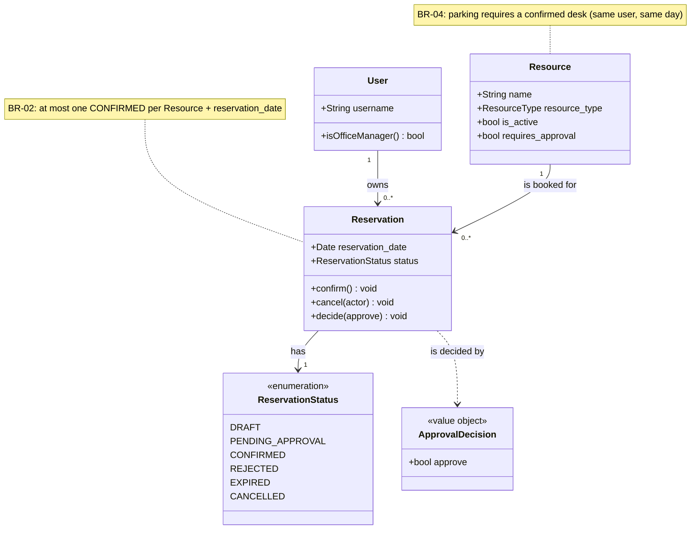
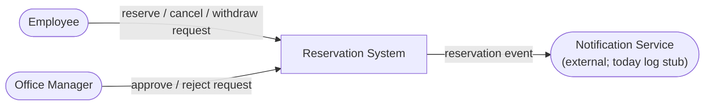
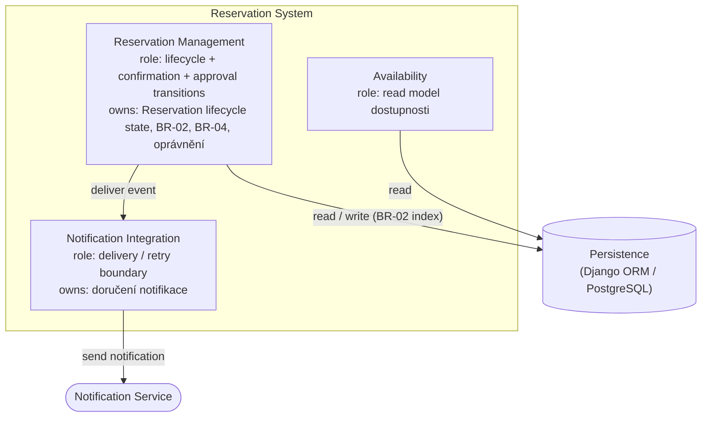
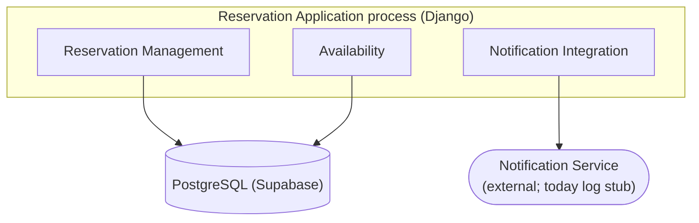
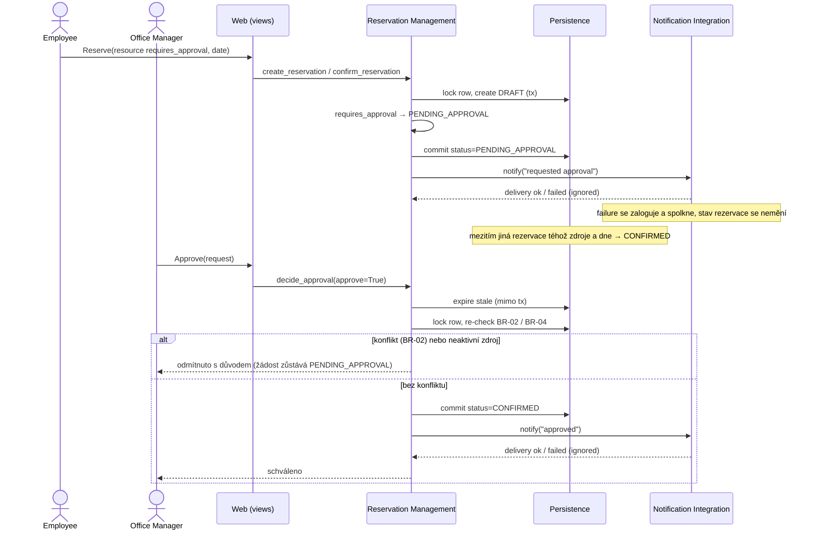
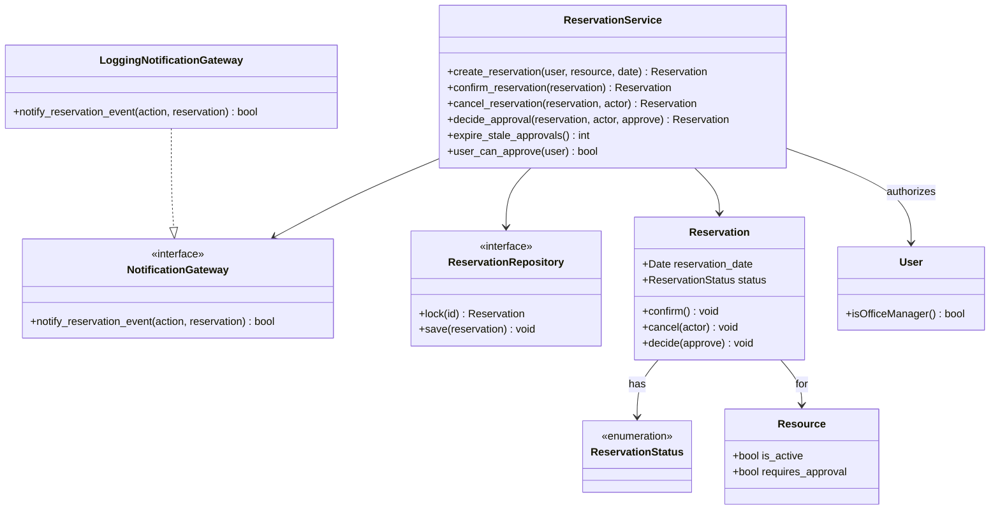

# C03 — Architecture

Od AS-IS implementace k přijaté architektuře pro scénář **potvrzení rezervace zdroje, který vyžaduje schválení**.

- **Baseline:** Specification Baseline v0.2 ([`docs/intent-and-change.md`](intent-and-change.md), sekce „Změna C02" a „Baseline v0.2").
- **Scénář:** OP-03 Confirm + OP-05 Approve pro zdroj s `requires_approval = True` (BR-05), včetně odloženého rozhodnutí a souběhu.
- **Poznámka k baseline:** aplikace navíc realizuje týmové rozhodnutí v0.3 (rezervace jedním krokem). Architektura je proto psaná nad statechartem v0.2 a odchylka v0.3 je vedená jako nález v cross-view kontrole (viz „I. Cross-view kontrola").
- Related: [`docs/architecture-and-decisions.md`](architecture-and-decisions.md) (AS-IS stack), [`docs/evidence-and-evolution.md`](evidence-and-evolution.md) (evidence).

---

## Část A — AS-IS: zmapování současné implementace

Kanonický AS-IS je v [`docs/architecture-and-decisions.md`](architecture-and-decisions.md), sekce **„Part A — AS-IS: mapování scénáře Confirm Reservation"** (A1–A9). Sem se nekopíruje, aby texty nedivergovaly.

**AS-IS závěr (shrnutí pro C03):** vlastnictví životního cyklu je koncentrované v `services.py` (dobrý základ), ale **notifikační integrace byla smíchaná s doménovou logikou** — neměla vlastníka pro failure/retry (viz delta v J).

---

## B. Architektonické drivery

| # | Driver | Podklad / zdroj | Proč ovlivňuje architekturu | Otázka, kterou musí architektura vyřešit |
| --- | --- | --- | --- | --- |
| **D1** | Rozhodnutí o konfliktu při souběhu | `BR-02`, `REQ-04` | dva souběžné requesty mohou oba vidět „bez konfliktu" | kde se musí udělat autoritativní confirmation decision, aby `BR-02` zůstalo pravdivé? |
| **D2** | Odložené schválení přežívá původní request | OP-05, `BR-05`, `BR-06` (evidence C02) | approval může přijít až po skončení requestu, který ho vyvolal | kdo vlastní *pending approval* stav a kdo provede pozdější přechod? |
| **D3** | `Notification Service` může selhat | Project Frame (externí závislost), OP-03/OP-05 | business změna může být uložená dříve než notifikace | má failure notifikace změnit výsledek confirmation a kdo řeší retry? |
| **D4** | Jedno místo pro rozhodnutí o oprávnění | dvě role z C02 (Employee, Office Manager) | oprávnění se nesmí rozhodovat na více místech odlišně | kde je jediné místo, které rozhodne „smí tento uživatel schválit"? |
| **D5** | Čas bez časovače | `BR-06` (expirace při čtení), evidence C02 | na stav „čeká na vypršení" se dá zapomenout | kde má být časová logika a kdo vlastní přechod do `EXPIRED`? |

**Driver není řešení.** „stejný deployable", „worker", „transakce" jsou až varianty odpovědí.

---

## C1. Doménový třídní model



- `Reservation` je **agregátní kořen** scénáře: vlastní stav životního cyklu i schvalovací stav.
- `reservation_date` nahrazuje `TimeInterval` (celodenní granularita, `BR-01`) — časové sloty se nemodelují.
- `Office Manager` je **role** (`User`), ne samostatný doménový pojem.

## C2. Odpovědnosti systému

| Zdroj | Odpovědnost | Co musí rozhodnout / vlastnit | Jeden owner? | Důvod |
| --- | --- | --- | --- | --- |
| Confirm + statechart | rozhodnout, zda je confirmation povolena | lifecycle transition | ano | různé části nesmí rozhodnout odlišně |
| `BR-02` | vyhodnotit konflikt a zachovat invariant | confirmation decision při konfliktu | ano | souběh nesmí porušit invariant |
| OP-05 (approval change) | spravovat *pending approval* | approve/reject/expire přechod | ano | stav přežívá původní request |
| role z C02 | rozhodnout o oprávnění schvalovatele | „smí tento uživatel schválit" | ano | pravidlo se nesmí duplikovat |
| OP-02 | vrátit dostupnost pro den | read model | ano | jen čtení, žádná alokace |
| Project Frame (`Notification Service`) | doručit notifikaci | delivery / retry | ano (dle návrhu) | externí failure nesmí být nejasný |
| Persistence | uložit a načíst stav | perzistence | ano | infrastruktura |

**Seskupení a oddělení:**

- Řádky *lifecycle transition*, *BR-02*, *pending approval* a *oprávnění* **musí být pohromadě** — sdílí tentýž stav (`Reservation.status`) a tentýž invariant (`BR-02`); kdyby je vlastnily oddělené prvky, mohly by rozhodnout odlišně.
- *Notifikace* **musí být oddělená** — jiná technologie, jiný důvod změny a failure/trust boundary; její selhání nesmí ovlivnit výsledek rezervace.
- *Dostupnost* je **oddělený read model** (jiný důvod změny: čtení/výkon).
- *Persistence* je **oddělená infrastruktura** (Django ORM).

---

## D. Hlavní rozhodovací otázka

```
Rozhodovací otázka:
Kde má být vlastněn odložený approval workflow — uvnitř stejného deployable
spolu s životním cyklem Reservation, nebo v samostatném runtime prvku
(Approval Worker / služba)?
```

Otázka vychází z **D2** (a dotýká se D1, D3, D5), má dopad na ownership, strukturu i runtime a má dvě reálné varianty.

---

## E1. Dvě materiálně odlišné alternativy

**Alternativa A — stejný deployable (approval workflow uvnitř aplikace)**

```
[Reservation Application process]
  ├─ [Reservation Management]
  │     role: lifecycle + confirmation decision
  │     owns: Reservation lifecycle state, BR-02, approval transitions
  ├─ [Availability]            (read model)
  └─ [Notification Integration]
```

Approval stav = `Reservation.status`; rozhoduje doménová služba v témže procesu. Expirace se vyhodnocuje **při čtení** (`BR-06`), žádný časovač.

**Alternativa B — samostatný runtime prvek (Approval Worker / služba)**

```
[Reservation Application]                 [Approval Worker / Service]
  ├─ [Reservation Management]   ── publish ──▶  owns: approval state
  └─ [Notification Integration]  ◀── decision ── scheduler: expiry (D5)
                                                 rozhoduje approve/reject
```

Approval stav žije mimo původní request; worker vlastní expiraci časovačem a oznamuje rozhodnutí zpět.

## E2. Porovnání alternativ vůči driverům

| Kritérium (z driveru) | Alternativa A | Alternativa B |
| --- | --- | --- |
| **Konzistence `BR-02` (D1)** | invariant drží jeden owner (`Reservation Management`) + DB index v téže transakci | `BR-02` se ověřuje ve dvou procesech; nutná distribuce zámku / idempotence |
| **Odložené schválení (D2)** | stav přežije request jako databázový řádek; pozdější přechod dělá táž služba | stav vlastní worker; aplikace musí řešit publish/decision protokol a jeho failure |
| **Failure notifikace (D3)** | izolovaná `Notification Integration`, best-effort, výsledek rezervace nezávisí | totéž + navíc možnost retry ve workeru bez zatížení web procesu |
| **Čas / expirace (D5)** | vyhodnocení při čtení; žádný časovač, ale na stav se může „zapomenout" | skutečný scheduler → proaktivní expirace, ale nový runtime a jeho provoz |
| **Provozní složitost** | jeden proces, jedna DB, `runserver`; nulové nové runtime | druhý proces, fronta/messages, monitoring, deploy navíc |
| **Ověřitelnost** | celý scénář v jednom testu (`manage.py test`), deterministický | potřeba integračního testu přes hranici + fake worker; nedeterminismus času |

## E3. Průchod obou alternativ jedním scénářem

Scénář: *Employee rezervuje zdroj vyžadující schválení → žádost → mezitím vznikne konkurující potvrzení téhož zdroje a dne → Office Manager schválí → notifikace selže.*

| Krok / událost | Alternativa A | Alternativa B |
| --- | --- | --- |
| `Confirm Reservation` začne | `confirm_reservation` v transakci; `requires_approval` → `PENDING_APPROVAL` | aplikace uloží žádost a **publish** ji workeru |
| je potřeba approval | žádost je řádek `PENDING_APPROVAL`; zdroj **neblokuje** dostupnost | žádost vlastní worker; aplikace jen čeká na decision |
| proces/request skončí | request skončí, stav zůstává v DB | request skončí; žádost přežívá ve workeru |
| approval přijde později | `decide_approval` znovu ověří `BR-02`/`BR-04` (`BR-07`) | worker pošle decision; aplikace musí ověřit invariant u sebe |
| relevantní souběh | konkurující `CONFIRMED` vznikne dřív → schválení **odmítnuto**, žádost zůstává `PENDING_APPROVAL` | totéž, ale rozhodnutí přichází přes hranici → nutná idempotence a řešení „decision na už změněný stav" |
| failure notifikace | `Notification Integration` zaloguje a **spolkne**; stav rezervace se nemění | stejně + retry ve workeru |

*Cíl: obě varianty umí požadované chování; liší se v tom, kdo vlastní odložený stav a jaké runtime to vyžaduje.*

---

## F. ADR

```
## ADR-01 — Kde je vlastněn odložený approval workflow

Kontext:
Změna C02 zavedla schvalovací proces (OP-05). Schválení může přijít pozdě,
být zamítnuto nebo vypršet. Systém je dnes jeden Django proces nad jednou DB.

Drivery:
D2 (odložené schválení), D1 (BR-02 při souběhu), D3 (failure notifikace),
D5 (expirace bez časovače), D4 (jedno místo pro oprávnění).

Alternativa A:
Approval workflow zůstává ve stejném deployable; stav vlastní
Reservation Management (services.py), expirace se vyhodnocuje při čtení.

Alternativa B:
Samostatný Approval Worker / služba vlastní approval stav, expiraci řeší
scheduler a rozhodnutí posílá zpět aplikaci.

Rozhodnutí:
Alternativa A.

Důvod:
BR-02 i approval stav se týkají téhož agregátu (Reservation), takže jeden
owner drží invariant konzistentně bez distribuovaného zámku (D1, D2). Projekty
tohoto rozsahu nepotřebují druhý runtime; jeden proces je ověřitelný jedním
testem a odpovídá AS-IS. Expirace při čtení pokrývá BR-06 bez časovače (D5).

Přijaté negativní důsledky:
- expirace žádosti proběhne až při čtení — bez proaktivní notifikace „vypršelo";
- notifikace nemá retry mimo request (jen best-effort log);
- approval zátěž jde přes web proces, nelze škálovat odděleně.

Rozhodnutí znovu otevřeme, když:
- poběží více instancí aplikace / bude potřeba horizontální škálování;
- bude potřeba proaktivní expirace nebo SLА doručení notifikací;
- schvalování se stane úzkým místem nebo vznikne požadavek oddělit runtime
  z bezpečnostních důvodů.
```

---

## G1. Kontext systému



Django vestavěná autentizace je **uvnitř** systému, proto zde žádný externí IdP není (na rozdíl od obecného příkladu v zadání).

## G2. TO-BE statická architektura



- **Reservation Management** vlastní každou změnu `Reservation.status` — včetně approval přechodů. Ownership odpovědností z C2: lifecycle transition, `BR-02`, pending approval, oprávnění.
- **Availability** je oddělený read model (jen čte).
- **Notification Integration** je oddělená failure/trust boundary (ADR-01/D3).
- **ADR-01 je v diagramu vidět:** neexistuje žádný samostatný „Approval Worker"; approval přechody vlastní Reservation Management (Alternativa A).

## G3. Ownership přechodů ve statechartu z C02

| Přechod | Owner rozhodnutí | Kdo může transition pouze vyžádat |
| --- | --- | --- |
| `DRAFT → PENDING_APPROVAL` | Reservation Management | vlastník rezervace (Confirm u zdroje s `requires_approval`) |
| `PENDING_APPROVAL → CONFIRMED` | Reservation Management | Office Manager (po novém ověření `BR-02`/`BR-04`) |
| `PENDING_APPROVAL → REJECTED` | Reservation Management | Office Manager |
| `PENDING_APPROVAL → EXPIRED` | Reservation Management | systém/čas (vyhodnocení při čtení, `BR-06`) |
| `PENDING_APPROVAL → CANCELLED` | Reservation Management | vlastník rezervace (stažení žádosti) |
| `DRAFT → CONFIRMED` | Reservation Management | vlastník rezervace |
| `DRAFT/CONFIRMED → CANCELLED` | Reservation Management | vlastník rezervace |

## G4. Runtime / deployment mapping



Logické prvky z G2 se mapují 1:1 do jednoho procesu; jediná sdílená databáze; externí jen `Notification Service` (dnes stub do logu).

---

## H1. Návrhový sekvenční diagram

Realizace přijaté TO-BE architektury pro scénář z E3.



Každá lifeline odpovídá prvku z G2 (`Reservation Management`, `Notification Integration`, Persistence) nebo aktéru; `Notification Service` je za `Notification Integration`.

## H2. Zaměřený návrhový třídní diagram



`ReservationService` je application service zodpovědný za ownership z C2; `NotificationGateway` je rozhraní integračního prvku (dnes `LoggingNotificationGateway` = `notifications.py`).

---

## I. Cross-view kontrola

| Kontrola | Otázka | Výsledek |
| --- | --- | --- |
| C02 ↔ G2 | Umí architektura realizovat požadované chování a pravidla? | **Ano.** OP-03 (→ approval), OP-05 (approve/reject/expire), `BR-02`/`BR-04`/`BR-05`/`BR-06`/`BR-07` mají ownera v Reservation Management. |
| C2 ↔ G2 | Má každá významná odpovědnost jednoho ownera? | **Ano** (viz G2/G3); notifikace a dostupnost jsou oddělené. |
| G2 ↔ H1 | Používá sekvence jen existující/povolené závislosti? | **Ano.** `RM → DB`, `RM → NI`, `NI → NS`; žádná nová hrana. |
| H1 ↔ H2 | Má každá významná zpráva/operace strukturálního vlastníka? | **Ano.** `decide_approval`/`confirm_reservation` → `ReservationService`. |
| statechart ↔ G3/H1 | Rozhoduje transition správný owner? | **Ano.** Všechny přechody vlastní Reservation Management. |
| G2 ↔ G4 | Je každý logický prvek realisticky namapovaný do runtime? | **Ano.** 1:1 do jednoho procesu + jedna DB. |
| ADR ↔ G2/G4 | Je přijaté rozhodnutí vidět v architektuře? | **Ano.** Žádný samostatný Approval Worker; expirace při čtení. |
| **Baseline v0.2 ↔ implementace v0.3** | Odpovídá text statechartu aplikaci? | **Nález (vedený, ne opravený):** UI provádí OP-01 + OP-03 jako jednu akci (`create_reservation`), takže `DRAFT` v běžném toku není pozorovatelný. V0.2 text i v0.3 popis zůstávají v [`intent-and-change.md`](intent-and-change.md) v sekci „Baseline v0.3"; architektura obojí podporuje (stejný owner), jen tok je kratší. |

*Rozpory opravené před změnou kódu:* žádný tvrdý rozpor v diagramech; jediný nález je známá a zdokumentovaná odchylka v0.3.

---

## J. AS-IS → TO-BE delta

| Oblast | AS-IS | TO-BE | Akce |
| --- | --- | --- | --- |
| změna `Reservation.status` | jen `services.py` | jen Reservation Management (`services.py`) | `KEEP` |
| approval stav | sloupec `status` na `Reservation` | totéž, vlastněno Reservation Management | `KEEP` |
| notifikační delivery | inline v `services.py` | izolováno v `notifications.py` | `CHANGE` |
| failure notifikace | může ovlivnit tok (volané v těle služby) | best-effort, spolknuté, výsledek nemění | `CHANGE` |
| persistence (ORM/DB) | Django ORM + PostgreSQL | stejné | `KEEP` |
| směr závislostí | views → services → models | + services → notifications; views nesmí sahat na integraci | `VERIFY` |
| approval runtime | žádný worker | žádný worker (ADR-01/A) | `KEEP` |

## K. Provedené změny implementace

- `reservations/notifications.py` — nový integrační prvek (Notification Integration): best-effort doručení, failure se zaloguje a spolkne, výsledek rezervace nemění.
- `reservations/services.py` — notifikace se volá přes nový modul; chování rezervace beze změny.
- `reservations/tests_architecture.py` — opakovatelná kontrola architektonického pravidla (L2).

## L1. Ověření chování

| Ověření | Výsledek | Doklad |
| --- | --- | --- |
| success path (žádost → schválení) | OK | `ApprovalTests.test_manager_approves_the_request`, `ApprovalViewTests` |
| failure path (konflikt `BR-02` při schválení) | OK | `test_approval_rechecks_the_parking_rule`, `test_second_request_for_the_same_resource_and_day_cannot_be_approved` |
| boundary / concurrency | OK | `test_parking_can_be_confirmed_after_desk`, souběžné potvrzení drží DB index |
| celý běžící set | **47 testů, `OK`** | `python manage.py test` |

## L2. Ověření architektonického pravidla

```
Architektonické pravidlo (RULE-1):
Pouze Reservation Management (balík reservations/services/) smí měnit stav
životního cyklu Reservation.status. Žádný jiný aplikační modul nesmí
přiřadit .status ani volat create/update s parametrem status.

Kontrola:
reservations/tests/test_architecture.py — AST sken modulů aplikace
(původně reservations/tests_architecture.py nad services.py, viz change record
„modules split by architecture element" v architecture-and-decisions.md)

Výsledek:
OK (viz M — Evidence)
```

Druhé pravidlo ze stejného ADR (RULE-2): doručení notifikace smí definovat pouze `reservations/integrations/notifications.py`. Kontrolováno stejným testem.

---

## Hotovo je, když (kontrola proti zadání)

- [x] 3–5 driverů podložených požadavky/evidencí (B, drivery D1–D5)
- [x] doménový model konzistentní s C02 (C1)
- [x] odpovědnosti explicitní s ownership (C2)
- [x] jedna decision question se dvěma variantami (D, E1)
- [x] porovnání vůči driverům + scénář (E2, E3)
- [x] ADR s negativními důsledky a „reopen" (F)
- [x] context / static / state ownership / runtime si neodporují (G1–G4, I)
- [x] scénář realizovaný sequence diagramem (H1)
- [x] design class diagram podporuje tutéž realizaci (H2)
- [x] cross-view kontrola před změnou kódu (I)
- [x] delta CHANGE/KEEP/VERIFY (J)
- [x] relevantní C02 verification po změně prochází (L1)
- [x] jedna opakovatelná kontrola chrání pravidlo (L2)
- [x] evidence a commit/tag — doplněno v [`docs/evidence-and-evolution.md`](evidence-and-evolution.md) (commit zatím neproveden, na pokyn týmu)
